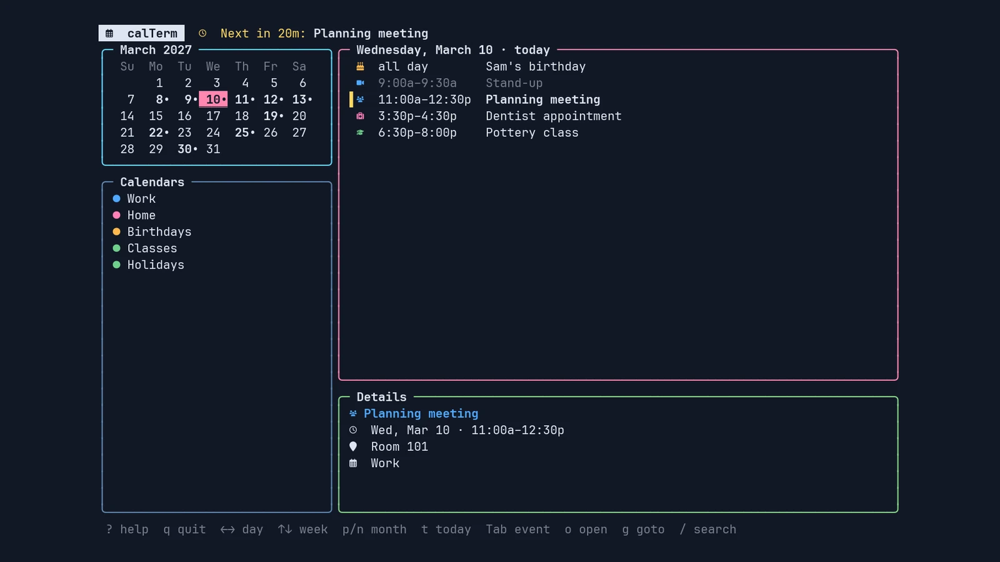
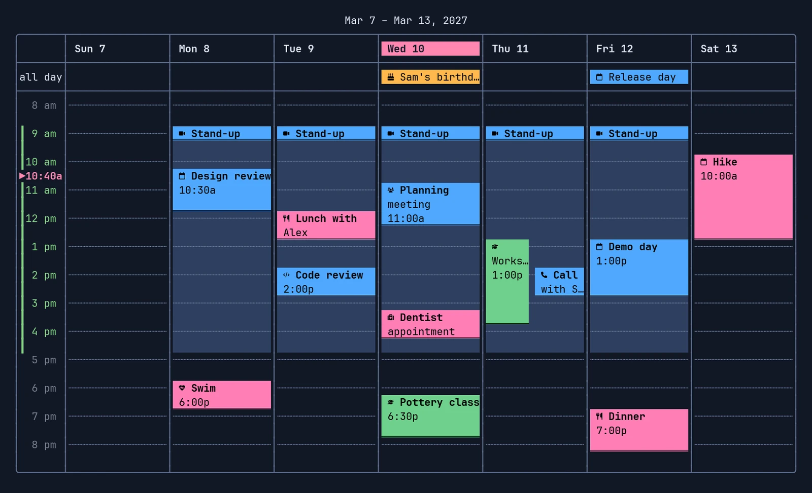
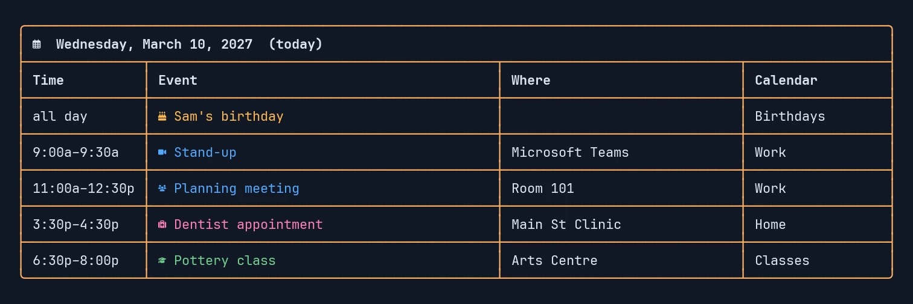
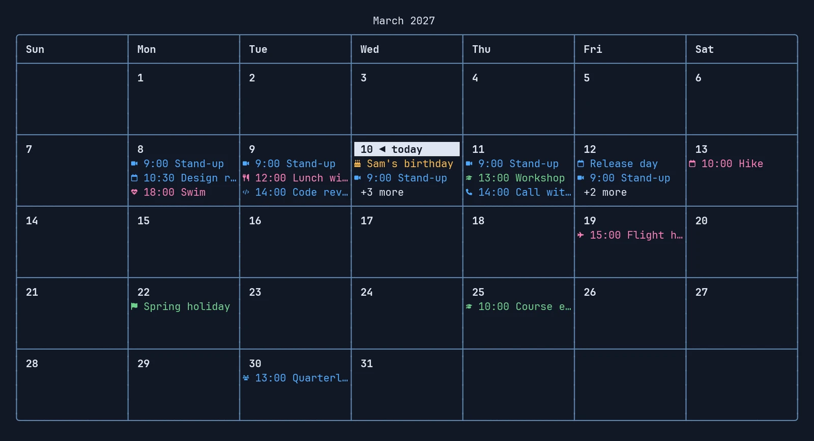

# calTerm

Your macOS Calendar in the terminal. The command is `ct`.

**[Read the story behind it on my blog](https://soft.me.uk/blog/posts/calterm-macos-calendar-in-the-terminal/)**

    brew install SOFTowaha/tap/calterm
    ct                    # month grid
    ct week               # hour-by-hour week
    ct day                # today
    ct nov 5              # any date
    ct ui                 # full-screen calendar (? shows the keys)

## Screenshots

All events shown are invented.

### Week (`ct week`)

### Day (`ct day`)

### Month (`ct`)

## Commands

    ct [ui|month|week|day|next|calendars|DATE] [+N|-N] [--json] [--no-color] [--no-icons]

DATE is plain English: `tomorrow`, `last friday`, `nov 11`, `next weekend`,
`in 3 days`, `next 2 weeks`.

## Details

- Requires macOS 14 or later. It shows the accounts added to the Calendar app,
  merging copies of an event that sync through more than one of them.
- It only reads events (macOS calls the permission it needs "Full Access"),
  makes no network requests of its own and runs no shell commands. In `ui`,
  pressing `o` opens an event's https link in your browser.
- Event icons need a [Nerd Font](https://www.nerdfonts.com); use `--no-icons`
  without one.
- The week view marks working hours, 9 to 5 on weekdays. Change them with
  `CT_WORK=8-16`.

## Development

    swift build -c release    # builds .build/release/ct
    swift test

## Credits

A fresh Swift take on the idea of
[icalBuddy](https://github.com/ali-rantakari/icalBuddy) by Ali Rantakari (MIT).
